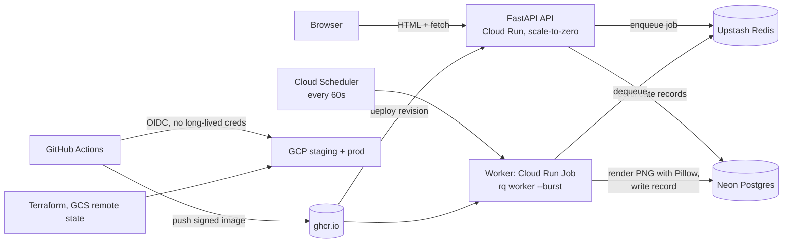

# Plan: Works On My Machine™ Certification Authority

A deliberately silly Python service that issues official-looking certificates stating that a developer's code "works on my machine" — complete with a fake serial number, a stamp, and a fake notary. The joke is that the project makes "works on my machine" actually true everywhere, which is exactly what containers and CI/CD are for. The app is the vehicle; the real product is a polished, production-style DevOps showcase: local dev with tests, multi-stage images, a signed supply chain, infrastructure as code, continuous delivery with rollbacks, and observability under chaos.

## 1. Locked decisions

| Decision | Choice | Why |
|---|---|---|
| Cloud | GCP, `us-central1` | Cloud Run scales to zero with a generous free tier (240k vCPU-seconds/month). Fargate needs an ALB + NAT (~$30/month minimum) before anything runs. Cloud Run also gives revision-based instant rollbacks, which the CD phase demonstrates. |
| Environments | Two GCP projects: `staging` and `prod` | Clean isolation, real environment separation, costs nothing extra. |
| Python | 3.12 | Stable everywhere: base images, Cloud Run runtime, wheels. The scaffold pinned 3.15; Phase 1 lowers it. |
| Packaging | `uv` | One tool for env + lockfile + builds; fast in CI. |
| Queue | RQ + Redis | ADR-001: Celery brings brokers, result backends, and beat; RQ is one process and one broker. "Keep it simple" wins. |
| Cloud data plane | Neon Postgres + Upstash Redis (free tiers) | GCP-native Memorystore + Cloud SQL run ~$60–90/month, 12× over budget. ADR-002 documents the trade-off honestly: third-party SaaS, manual signup, but $0/month. Upstash needs TLS (`rediss://`). |
| Worker hosting | Cloud Run Job triggered by Cloud Scheduler every minute (`rq worker --burst`) | ~$0/month. Trade-off: certificate latency up to ~60s. The API already polls status, and latency is part of the joke. Always-on min-instances would cost ~$45/month. |
| Registry | ghcr.io | Per spec. Images must be public so Cloud Run can pull them without credentials; see open items. |
| IaC | Terraform + GCS remote state, GitHub OIDC (Workload Identity Federation) | No long-lived credentials in GitHub or the repo, ever. |
| Observability | Prometheus + Grafana in docker-compose for local demos; Cloud Monitoring in the cloud | Honest limitation: Cloud Run instances are ephemeral, so scraping `/metrics` from a Prometheus is unreliable there. This gap is documented, not papered over. |
| Signing / SBOM | cosign keyless (GitHub OIDC) + Syft SBOM + Trivy SARIF | Standard open-source supply-chain stack; keyless works because GitHub Actions issues ambient OIDC tokens. |

## 2. Architecture



The same system runs locally with `docker compose up`: api, worker, redis, postgres, prometheus, grafana. The cloud mirrors it as a cheaper, more faithful production.

## 3. Tool choices

| Area | Tool | Rationale |
|---|---|---|
| Web | FastAPI + uvicorn + pydantic-settings | async, typed, native OpenAPI docs |
| DB access | SQLAlchemy 2.0 + Alembic | boring, standard, interview-safe |
| Rendering | Pillow | only sane choice |
| Metrics | prometheus-client | stdlib for FastAPI |
| Tests | pytest + httpx + fakeredis (unit); testcontainers (integration) | fast unit loop; real Postgres only where it matters |
| Quality | ruff (lint + format), mypy, pre-commit | one linter/formatter, strict types |
| CI/CD | GitHub Actions, actions pinned by commit SHA, buildx cache, hadolint, Trivy, Syft, cosign | matches the supply-chain bar |
| IaC | Terraform + tflint | plan as PR comment, validate in CI |
| Load testing | k6 | standard |
| Local observability | Prometheus + Grafana (compose), alert rules as code | dashboards as JSON, committed |

## 4. Budget (honesty table)

| Item | Cost/month |
|---|---|
| Cloud Run (API scale-to-zero + job) | $0 (free tier) |
| Cloud Scheduler (1 job) | $0 (3 free) |
| GCS Terraform state (KBs) | $0 |
| Secret Manager (few secrets) | $0–$0.24 |
| Neon Postgres free tier | $0 |
| Upstash Redis free tier | $0 |
| GHCR storage | $0 |
| Egress at demo scale | $0 |
| **Total** | **≈ $0–2; worst case ~$10 if free tiers exhaust** |

Anything that can cost money gets a warning before it is used. `make destroy` tears down everything Terraform created. The runbook lists what destroy cannot remove (the Neon and Upstash accounts themselves).

## 5. Repository layout

```
app/                       # FastAPI application code
worker/                    # RQ worker + Pillow renderer
tests/                     # pytest (unit + API + integration)
migrations/                # Alembic
docker/                    # Dockerfile.api, Dockerfile.worker, Dockerfile.naive
docker-compose.yml         # full local stack
docker-compose.chaos.yml   # chaos profile
.github/workflows/         # ci.yml, cd.yml, nightly-chaos.yml
infra/terraform/           # modules/, environments/{staging,prod}/, bootstrap/
observability/             # prometheus.yml, alertrules.yml, dashboards/*.json
loadtest/                  # k6 scripts
docs/                      # architecture.md, adr/, runbook.md
Makefile                   # the single entry point
README.md                  # pitch, diagrams, cost, lessons learned
pyproject.toml             # uv project, deps, tool config
.pre-commit-config.yaml
```

## 6. Phases

Each phase ends with a summary (what was built, how to verify it) before the next one starts.

### Phase 1 — Local app + tests
App, worker, Alembic migrations. Unit tests (fakeredis), API tests (httpx), integration tests (testcontainers). ruff, mypy, pre-commit. 80%+ coverage on core logic.
**Acceptance:** `make test` and `make lint` pass.

### Phase 2 — Containerization
Multi-stage Dockerfiles: slim Python base, builder stage for deps, non-root user, read-only root filesystem where possible (tmpfs for `/tmp`), HEALTHCHECK, no secrets in images, correct `.dockerignore`. Compose stack with healthchecks and `depends_on: condition: service_healthy`. A deliberately naive Dockerfile plus a script that builds both and prints a size/layer comparison table, results in the README.
**Acceptance:** `docker compose up` brings the whole system up; a certificate can be requested end to end.

### Phase 3 — CI (GitHub Actions)
On PR and push to main: ruff, mypy, pytest with coverage, hadolint. buildx builds with a cache, matrix on linux/amd64 (arm64 optional). Trivy fails on HIGH/CRITICAL, SARIF to the Security tab. Syft SBOM as a build artifact. On main: push to GHCR tagged with git SHA + semantic version, cosign keyless signing. A failing job posts a random developer "excuse" into the job summary. All actions pinned by SHA, least-privilege `permissions:`, concurrency control, Dependabot.
**Acceptance:** green pipeline with a signed image in GHCR.

### Phase 4 — Infrastructure as Code
Terraform: two GCP projects, GCS remote state (bootstrap script), GitHub OIDC federation, Secret Manager, Cloud Run service + job + Scheduler, least-privilege IAM. CI runs `terraform fmt`, `validate`, `tflint`, and `plan` as a PR comment. Infracost only if it fits the budget (needs an API key, so off by default).
**Acceptance:** `terraform apply` creates a working staging environment; `make destroy` removes it cleanly.

### Phase 5 — Continuous Deployment
Main merge or version tag → deploy staging → smoke test (request a certificate, verify the PNG) → promote to prod behind a GitHub Environment manual approval. Rolling rollout with automatic rollback if the post-deploy health check or smoke test fails (Cloud Run traffic split). The rollback is demonstrated once with a deliberately broken release. Custom domain + HTTPS documented, not purchased.
**Acceptance:** a push reaches staging automatically; prod requires one approval click.

### Phase 6 — Observability and chaos
Prometheus config, alert rules (error rate, queue backlog), Grafana dashboards as JSON: request rate, error rate, p95 latency, queue depth, certificates per minute, and the `machines_certified_total` gauge. Chaos mode: a script/compose profile randomly kills the worker or API while k6 runs; the dashboard shows recovery. Short, cheap k6 run demonstrates Cloud Run autoscaling. A recording script is provided; the GIF in the README is recorded by hand (no fakes).
**Acceptance:** a live dashboard during chaos that can be explained step by step.

### Phase 7 — Documentation and polish
README: one-paragraph pitch, Mermaid architecture diagram, skills-demonstrated table (Docker, CI/CD, IaC, security, observability, cloud), quick start, pipeline diagram, image size comparison, screenshots/GIFs, cost breakdown, lessons learned. 4–6 ADRs (RQ over Celery, cloud data-plane choice, OIDC over static keys, Trivy + cosign, worker model). Runbook: deploy, roll back, rotate secrets, debug a failing release.
**Acceptance:** a stranger clones the repo, runs `make up`, and understands the project in 5 minutes.

## 7. Conventions

- Conventional commits, small and logical; one concern per commit.
- The Makefile is the single entry point; README and runbook only document make targets.
- No secrets in git, in images, or in GitHub settings — ever. Cloud credentials exist only as short-lived OIDC tokens.
- Honesty over theater: anything that costs money, is flaky, or needs a manual step is said so and documented. No invented results, no fake screenshots.
- Type hints everywhere, pydantic settings, structured JSON logging, graceful shutdown.

## 8. Open items

- GitHub repo name and ghcr.io image visibility (public recommended so Cloud Run can pull without credentials) — needed before Phase 3.
- A GCP project with a billing account (free tier) — needed before Phase 4.
- Neon and Upstash account signup — one-time manual step, documented in the runbook.

## 9. Risks

- Free-tier exhaustion → every paid resource is behind a warning and removable with `make destroy`.
- Upstash requires TLS (`rediss://`) — handled in settings, tested locally.
- Ephemeral Cloud Run instances vs. Prometheus scraping → Cloud Monitoring in cloud, local stack for demos; documented.
- cosign keyless depends on GitHub Actions OIDC → pinned action versions, verified in Phase 3.
